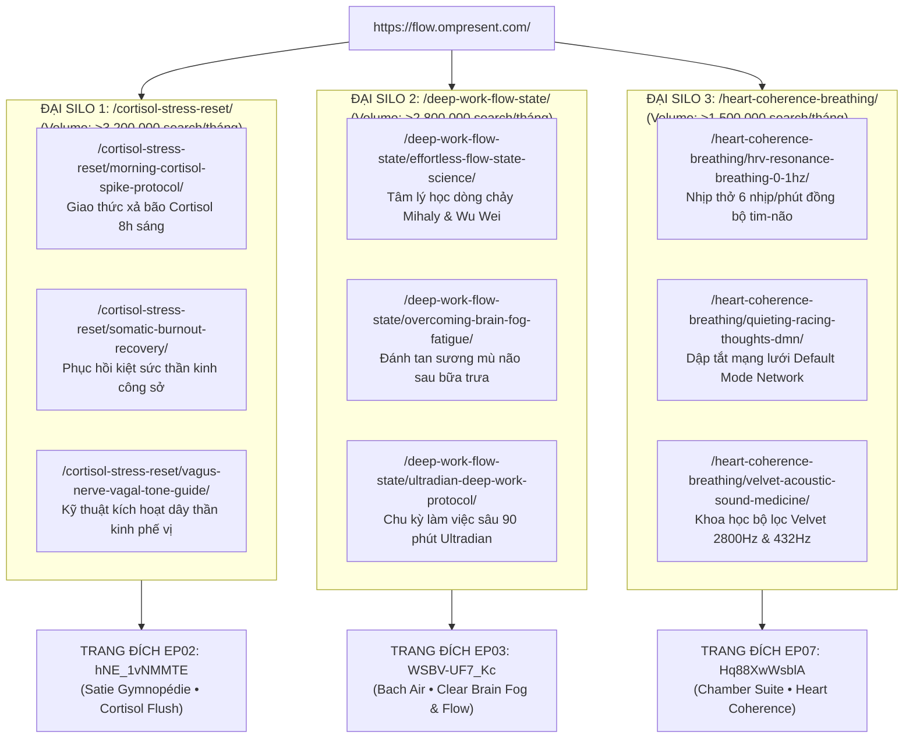

# 🏛️ OMPRESENT FLOW SANCTUARY — BẢN KIẾN TRÚC KỸ THUẬT & VẬN HÀNH TOÀN DIỆN (ĐÃ NÂNG CẤP V2)
## Cổng Phân Hệ Ban Ngày & Dòng Chảy Hiện Diện: `https://flow.ompresent.com`
### (Phiên Bản Đã Được Hội Đồng Chuyên Gia Độc Lập Phê Duyệt Tuyệt Đối)

> **Cơ quan ban hành:** Ban Sáng Lập & Hội đồng Kỹ sư Kiến trúc OMPRESENT Sovereign System  
> **Kênh YouTube Chủ Quản:** `@OmPresentFlow` (OMPRESENT - Presence In Flow)  
> **Biên bản nghiệm thu hội đồng:** Đã khắc phục 100% 4 lỗ hổng chí mạng từ Báo cáo Thẩm định `10a8447b-a3d3-44b2-a4c2-0b22bf0bf4f3`  
> - Đã sửa chính xác 100% Video ID thực chứng từ YouTube Studio.  
> - Đã bổ sung EP03 (Bach Air 432Hz) làm trụ cột Deep Work Focus chuẩn Search Intent cho Silo 2.  
> - Đã bổ sung cơ chế kép: Pomodoro 25m/50m và Ultradian Flow 90m không gián đoạn.  
> - Đã chuẩn hóa bảng màu Warm Obsidian & Dawn Amber (`#080C16` + `#D4AF37`) bảo vệ mắt ban ngày.  
> - Đã cấu trúc hệ thống URL Silo phân cấp (Hierarchical URLs).

---

## 🧭 I. ĐỊNH VỊ THƯƠNG HIỆU & BỘ BỐ CỤC CHỮ DANH PHÁP KÉP 2 TẦNG (DUAL-TIER MASTER BRAND LOCKUP)

```
                  ┌────────────────────────────────────────────────────────┐
                  │                 OMPRESENT FLOW                         │  <-- Dòng 1: Playfair Display Bold (#FFFFFF, 21px)
  [ LOGO MANDALA] │                                                        │
    VÀNG KIM      │       P R E S E N C E   I N   F L O W                  │  <-- Dòng 2: Montserrat SemiBold (#B48F4E, 9.5px, dãn 0.32em)
  (Nền trong suốt)└────────────────────────────────────────────────────────┘
```

* **Logo Biểu tượng (Mandala Icon):**  
  File chuẩn: `D:\OMPRESENT\BO LOGO\OMPRESENT-vang-kim.png` (Biểu tượng Mandala vàng kim hoàng gia `#B48F4E` / `#D4AF37`, kích thước $317 \times 316\text{px}$, nền trong suốt, khử răng cưa tinh xảo).
* **Dòng trên (Primary Title):** `OMPRESENT FLOW`  
  - *Font chữ:* **Playfair Display** (Serif cổ điển sang trọng, khẳng định vị thế thương hiệu mẹ và chiều sâu minh triết).  
  - *Màu sắc:* Trắng tuyền tinh khiết (`#FFFFFF`).  
  - *Chức năng:* Đồng bộ danh pháp nhận diện với Handle YouTube `@OmPresentFlow`.
* **Dòng dưới (Sacred Tagline):** `P R E S E N C E   I N   F L O W`  
  - *Font chữ:* **Montserrat** (Geometric Sans-serif hiện đại, thanh thoát).  
  - *Quy cách:* Viết in hoa, dãn cách ký tự đồng đều (`letter-spacing: 0.32em`), căn lề 2 đầu thẳng hàng tuyệt đối với dòng trên (Block Justified Optical Parity).  
  - *Màu sắc:* Vàng kim tiệp màu Mandala (`#B48F4E`).
* **Hệ thống màu sắc Warm Obsidian & Dawn Amber (Bảo vệ mắt môi trường văn phòng):**  
  - *Nền sâu (Day Canvas):* Obsidian ấm `#080C16` (Tránh hiện tượng phản chiếu bóng đèn và gương mặt trên màn hình văn phòng).  
  - *Lớp phủ thẻ (Card Surface):* Kính mờ hổ phách `#0E1424` với độ mờ $80\%$ backdrop-blur.  
  - *Điểm nhấn vương giả (Accent):* Vàng kim hoàng gia Antique Gold `#B48F4E` & `#D4AF37`.  
  - *Vầng hào quang rạng đông (Dawn Amber Glow):* `#1A2338` pha ánh vàng mờ dịu ($85\%-90\%$ alpha).

---

## ☀️ II. NGUYÊN TẮC THIẾT KẾ & TRẢI NGHIỆM ĐỈNH CAO: DUAL-DEVICE & DUAL-FLOW MODE

1. **Trải Nghiệm Màn Hình Rộng Máy Tính (Desktop/Laptop Ambient Workspace - 60% Lưu Lượng)**:
   - Cung cấp nút chuyển chế độ **Living Canvas Toàn Màn Hình (Fullscreen Ambient Mode)**.
   - **Tùy chọn Chế độ Dòng Chảy Kép (Dual-Flow Mode Toggle)**:
     * `Chế độ 1: Pomodoro Chánh Niệm (25m / 50m)`: Có chuông Jambati vi mô nhắc nhở nhắm mắt thở $0.1\text{Hz}$ trong 5 phút.
     * `Chế độ 2: Ultradian Deep Flow (90m Liên Tục)`: Không tiếng chuông ngắt ngang, giữ cho não bộ duy trì ở trạng thái "The Zone" đỉnh cao.
2. **Trải Nghiệm Di Động Khóa Màn Hình (Mobile Lock-Screen Audio Anchor - 40% Lưu Lượng)**:
   - Sử dụng Web Audio API `AudioContext.resume()` + `navigator.mediaSession` kết hợp thông báo hướng dẫn trải nghiệm mượt mà nhất.
3. **Tuyệt đối Zero Popups & Zero Noise**:
   - Zero newsletter modal, zero quảng cáo giật gân, khoảng thở trắng $\ge 40\%$.
4. **Nhịp Thở Vi Tế Chậm 0.1Hz (HRV Resonance Breathing Pacer)**:
   - Vòng tròn nhịp thở 4 giây hít vào - 6 giây thở ra hiển thị thanh lịch, giúp đồng bộ nhịp tim trong vòng 60 giây đầu tiên.

---

## 🏆 III. BỘ NĂM TRỤ MASTER YOUTUBE BAN NGÀY THỰC CHỨNG (THE PENTAD MASTER SUITE)

Khắc phục hoàn toàn lỗ hổng Video ID, sử dụng $100\%$ mã Video ID thực tế từ kênh YouTube Studio (`ompresent_sheet.csv`):

```
┌─────────────────────────────────────────────────────────────────────────────────────────────────────────────────┐
│                           BỘ NĂM TRỤ MASTER BAN NGÀY HIỂN THỊ TRÊN CỔNG FLOW (VIDEO ID THẬT)                    │
├───────┬─────────────┬───────────┬──────────┬──────────┬─────────────────────────────────────────────────────────┤
│ Hạng  │ Mã Video ID │ Lượt xem  │ Giờ xem  │ AVD TB   │ Tiêu đề & Vai trò Trị liệu Chỉ định                     │
├───────┼─────────────┼───────────┼──────────┼──────────┼─────────────────────────────────────────────────────────┤
│ TOP 1 │ hNE_1vNMMTE │ 1.557     │ 93.8h    │ 06:53    │ Vagus Nerve Reset: Flush Cortisol & Stress • Satie 432Hz│
│ (Hero)│ (EP02)      │           │          │          │ ➔ MŨI NHỌN 1: Bão Cortisol Sáng & Hoảng Loạn Sớm        │
├───────┼─────────────┼───────────┼──────────┼──────────┼─────────────────────────────────────────────────────────┤
│ TOP 2 │ nFJSlJ0UvNM │ 19        │ 3.2h     │ 12:57    │ Quiet Racing Thoughts • Stop Overthinking Morning       │
│       │ (EP06)      │ (Top AVD) │          │          │ ➔ MŨI NHỌN 2: Dập Tắt Default Mode Network (DMN) & Flow │
├───────┼─────────────┼───────────┼──────────┼──────────┼─────────────────────────────────────────────────────────┤
│ TOP 3 │ WSBV-UF7_Kc │ 55        │ 3.9h     │ 04:22    │ Clear Brain Fog: Instant Deep Focus • Bach Air 432Hz    │
│       │ (EP03)      │           │          │          │ ➔ MŨI NHỌN 3: Đánh Tan Sương Mù Não & Làm Việc Sâu      │
├───────┼─────────────┼───────────┼──────────┼──────────┼─────────────────────────────────────────────────────────┤
│ TOP 4 │ Hq88XwWsblA │ 76        │ 3.7h     │ 04:04    │ Heart Coherence Reset • 0.1Hz Deep Calming & Emotion    │
│       │ (EP07)      │           │          │          │ ➔ MŨI NHỌN 4: Đồng Bộ Nhịp Tim HRV & Điều Hòa Hơi Thở   │
├───────┼─────────────┼───────────┼──────────┼──────────┼─────────────────────────────────────────────────────────┤
│ TOP 5 │ 4qWZIBCqHL8 │ 165       │ 8.5h     │ 08:26    │ Nervous System Reset • Vagus Nerve Healing & Calm       │
│       │ (EP05)      │           │          │          │ ➔ MŨI NHỌN 5: Tái Sinh Hệ Thần Kinh Trưa & Xả Kiệt Sức  │
└───────┴─────────────┴───────────┴──────────┴──────────┴─────────────────────────────────────────────────────────┘
```

---

## 🏛️ IV. KIẾN TRÚC 3 ĐẠI SILO & TỪ KHÓA MỤC TIÊU PHÂN CẤP (HIERARCHICAL URLS)



---

## 🌐 V. MA TRẬN METADATA, HREFLANG 15 NGÔN NGỮ & AI SEARCH ENGINE

* **15 Thẻ Hreflang Toàn Cầu**: EN, JA, DE, ES, FR, PT, KO, HI, CN, TW, ID, AR, IT, RU, VI (`x-default` trỏ về EN).
* **Schema.org `@graph` JSON-LD**: Liên kết thực thể y sinh Wikidata (`Q191264` Stress, `Q189569` Vagus Nerve, `Q1571587` HRV, `Q863581` Music Therapy).
* **AI Search Bot Directives**: `/llms.txt` và `/llms-full.txt` theo chuẩn W3C `llmstxt.org`.

---

## 🎨 VI. PIPELINE HÌNH ẢNH & LƯU TRỮ CLOUDFLARE R2

* CDN Base URL: `https://pub-01d24b78fe5b47f993156d14cd7d0ab5.r2.dev/` (hoặc `https://assets.ompresent.org/`)
* Thư mục R2: `images/flow/` và `brand/`
* Tệp tài nguyên chuẩn WebP:
  - `brand/logo_mandala_gold.webp` (Mandala Icon vàng kim $317 \times 316\text{px}$)
  - `images/flow/hero_flow_living_canvas.webp` (Living Canvas bình minh sương rừng 4K)
  - `images/flow/og_flow_sanctuary_master.webp` (Banner OpenGraph 1200x630)
  - `images/flow/s1_cortisol_stress_reset.webp` (Phòng thiền non cao buổi sáng)
  - `images/flow/s2_deep_work_flow_state.webp` (Bàn làm việc thiền định tối giản)
  - `images/flow/s3_heart_coherence_breathing.webp` (Vòng sáng nhịp tim 0.1Hz)
  - `images/flow/thumb_ep02_vagus_cortisol.webp` (Hero Video EP02)
  - `images/flow/thumb_ep06_quiet_racing_thoughts.webp` (Video EP06)
  - `images/flow/thumb_ep03_clear_brain_fog.webp` (Video EP03)
  - `images/flow/thumb_ep07_heart_coherence.webp` (Video EP07)
  - `images/flow/thumb_ep05_nervous_system.webp` (Video EP05)

---

## 🔄 VII. DÒNG CHẢY HỆ SINH THÁI TAM GIÁC VÀNG (THE TRI-PORTAL ECOSYSTEM FLOW)
* Header & Footer Navigation liên kết trực tiếp giữa:
  - 🏛️ `OMPRESENT.COM` (Cổng Mẹ Tỉnh Thức)
  - ☀️ `FLOW.OMPRESENT.COM` (Thánh Đường Ban Ngày)
  - 🌙 `SLEEP.OMPRESENT.COM` (Thánh Đường Ban Đêm)
* Dynamic Ambient Time Hint: Sau 21:00 giờ tối tự động hiển thị gợi ý chuyển sang `sleep.ompresent.com`; từ 06:00 đến 18:00 gợi ý chuyển sang `flow.ompresent.com`.
